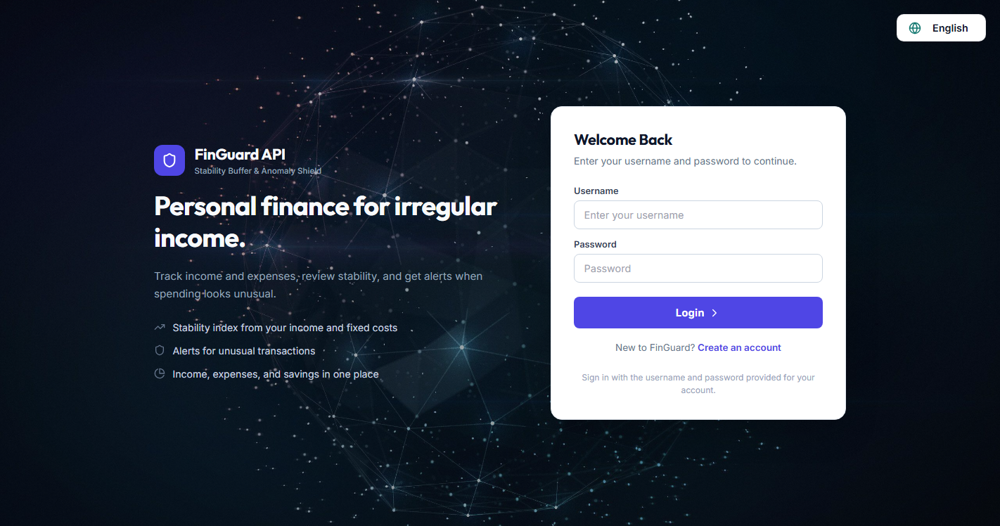
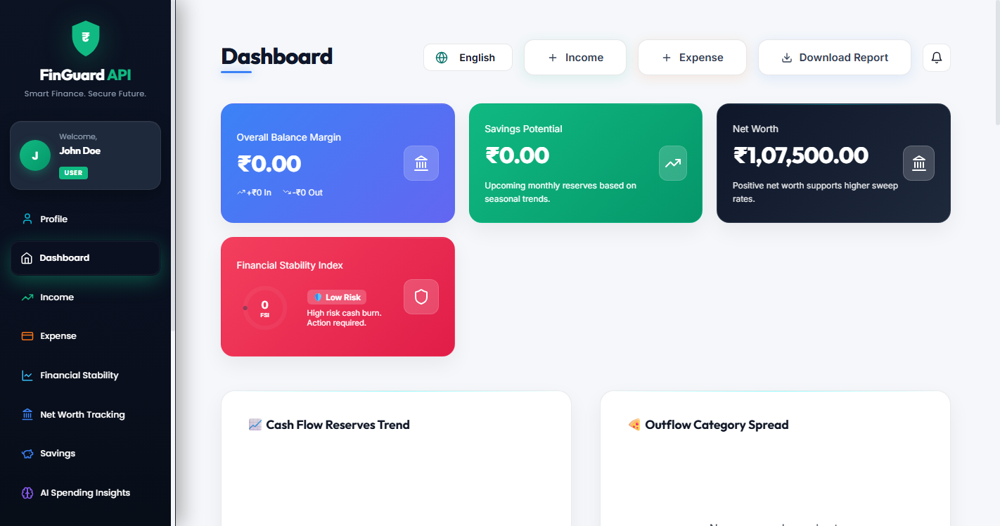
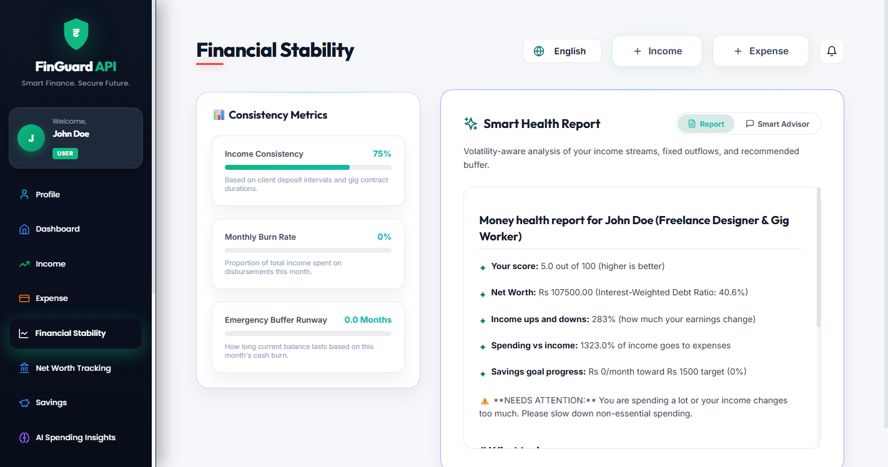
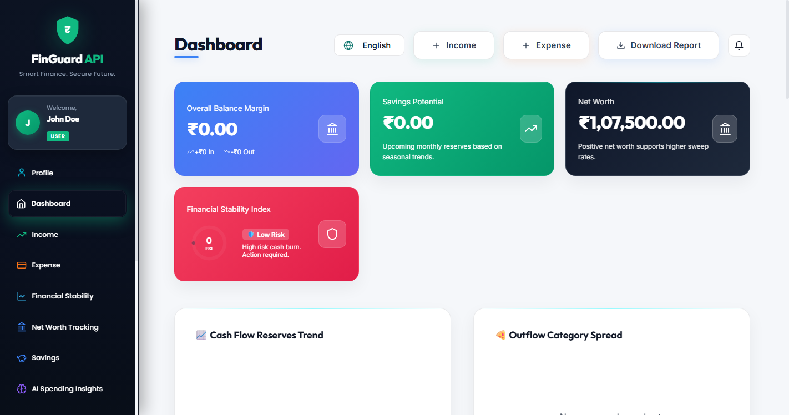
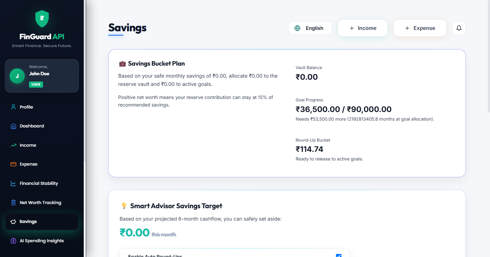
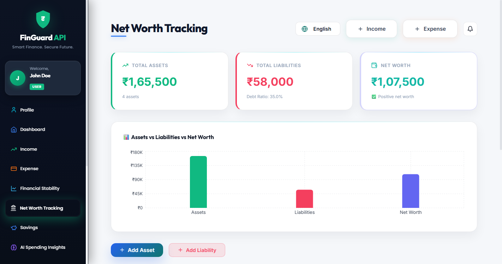
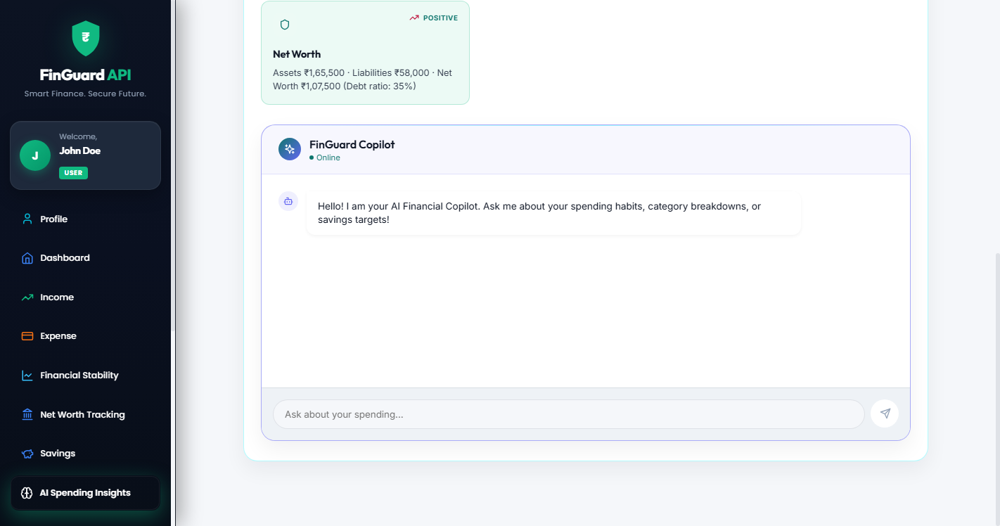
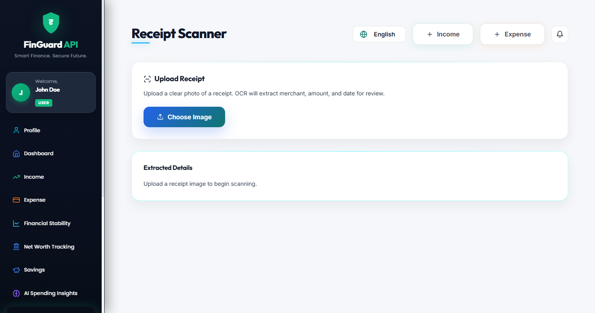
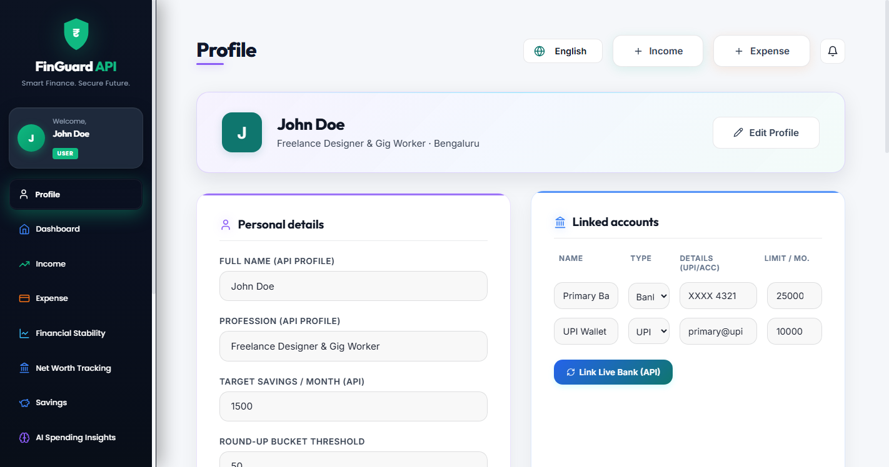

# FinGuard API 🛡️ 

**Intelligent Financial Stability Advisor & Transaction Anomaly Shield**

FinGuard API is a production-grade full-stack financial platform designed to help freelancers, gig-economy workers, and variable-income professionals manage their volatile cash flows. The platform calculates a dynamic Financial Stability Index (FSI), hosts a Cushion Vault (Stability Sweep), and detects real-time transaction anomalies.

---

## 📸 Application Screenshots

### 1. Authentication & Onboarding

*Secure stateless JWT authentication with pre-seeded gig-worker sandbox personas.*

### 2. Main Financial Dashboard

*Real-time executive financial dashboard highlighting income, expenses, liquid balance, and FSI score.*

### 3. Financial Stability Index (FSI) & Weather Forecast

*Algorithmic Stability calculation incorporating burn rates, volatility index, debt ratios, and AI suggestions.*

### 4. Income Management

*Multi-source income tracking supporting freelance retainers, gig earnings, and overtime payouts.*

### 5. Expense Tracking & Anomaly Detection

*Detailed category breakdown, budget monitoring, and real-time outlier detection.*

### 6. Savings Goals & Auto Round-Up

*Goal vault with automated round-up spare-change sweeping and progress tracking.*

### 7. Net Worth & Asset/Liability Ledger

*Consolidated asset and debt ledger calculating real-time balance sheets and weighted debt ratios.*

### 8. AI Spending Insights & Recommendations

*Explainable machine learning and rule-based advisory providing tactical spending optimizations.*

### 9. Smart Receipt OCR Scanner

*Client-side OCR processing for automated receipt parsing, merchant detection, and direct expense logging.*

### 10. User Profile & Preferences

*Configurable cushion vault sweeps, UPI spending thresholds, and account aggregator linkages.*

---

## 🌟 Key Capabilities
* **Financial Stability Index (FSI)**: Evaluates income volatility, monthly burn rate, and balance thresholds to generate a dynamic safety index.
* **Stability Vault Configurator**: Supports automated payout sweeps (moves 15% of inbound income to reserves), UPI spending ceilings, and manual sandbox vault deposits.
* **Auto Round-Up Savings Bucket**: Supports a configurable round-up threshold with fallback reserve behavior when no active savings goals are available.
* **6-Month Trend Charting**: Displays a historical line chart tracking stability scores alongside an interactive Cushion Vault Status Panel.
* **Account Aggregator Consent Flow**: Simulates a high-fidelity Indian Open Banking linkage (via Sahamati framework) to pull live starting balances.
* **Conversational AI Advisor (AI Advisor)**: Suggests savings projections (7.2% CAGR yield), tactical budgets, proportional household expense splits, and flags outliers.
* **Real-time Anomaly Shield**: Dynamically flags double-billing velocity spikes and outlier expense transactions.

---

## 💻 Technology Stack
* **Frontend**: React 18, Vite, Recharts (visualizations), Lucide React (icons), Vanilla CSS (Slate Dark styling).
* **Backend**: Java 17, Spring Boot 3.2.x, Spring Data JPA, Spring Security (Stateless JWT).
* **Database**: H2 In-Memory DB (default for local sandbox dev) / PostgreSQL profile support.
* **API Documentation**: Springdoc OpenAPI (Swagger UI).

---

## 📂 Repository Layout
```text
FinGuardAPI/
|-- backend/
|   |-- src/main/java/com/finguard/api/
|   |   |-- config/          # JWT Security, Web CORS, Data Seeder
|   |   |-- controller/      # REST API Controllers (Swagger Annotated)
|   |   |-- dto/             # Immutable Java 17 records
|   |   |-- entity/          # JPA Hibernate Entities
|   |   |-- exception/       # Global RestAdvice Interceptors
|   |   |-- repository/      # Spring Data JPA interfaces
|   |   `-- service/         # Business Logic, FSI Math, Anomaly Interceptors
|   |-- pom.xml              # Maven configuration
|   `-- Dockerfile
|-- frontend/
|   |-- src/
|   |   |-- App.jsx          # Main SPA (State management, API integration, views)
|   |   |-- index.css        # Slate Dark global stylesheets and utility classes
|   |   `-- main.jsx         # React DOM renderer
|   |-- package.json         # npm dependencies
|   |-- vite.config.js       # Vite configuration
|   `-- Dockerfile
|-- docs/
|   `-- images/              # High-resolution screenshots of verified modules
`-- docker-compose.yml       # Orchestrated multi-stage local containers
```

---

## 🚀 Getting Started

### Manual Local Startup (Recommended)

#### 1. Spin Up the Spring Boot Backend
1. Navigate to the backend folder:
   ```bash
   cd backend
   ```
2. Compile and run the server using the Maven wrapper:
   ```bash
   ./mvnw spring-boot:run
   ```
3. The server starts on port **`9080`**.
   * **API Swagger Console**: [http://localhost:9080/swagger-ui.html](http://localhost:9080/swagger-ui.html)
   * **H2 Database Console**: [http://localhost:9080/h2-console](http://localhost:9080/h2-console) (JDBC URL: `jdbc:h2:mem:finguarddb`, Username: `sa`, Password: `password`)

#### 2. Spin Up the React Frontend
1. Navigate to the frontend folder:
   ```bash
   cd ../frontend
   ```
2. Install npm packages:
   ```bash
   npm install
   ```
3. Boot the Vite development server:
   ```bash
   npm run dev
   ```
4. Open your browser and navigate to [http://localhost:5173/](http://localhost:5173/).

---

## 🔑 Sandbox Credentials
To access pre-seeded 180-day historical worker datasets, use the following credentials on the login screen:

* **Password (Common for all accounts)**: `password123`

| Username | Full Name | Profession / Persona |
| :--- | :--- | :--- |
| `demo` | John Doe | Freelance UI/UX Designer |
| `priya_s` | Priya Sharma | Delivery Driver - Uber/Ola |
| `kabir_v` | Kabir Verma | YouTuber & Content Creator |
| `rahul_d` | Rahul Das | Quick Commerce Rider (Zepto/Blinkit) |
| `amit_p` | Amit Patel | Urban Company Plumber & Service Pro |
| `rajesh_k` | Rajesh Kumar | Daily Wage Construction Laborer |
| `divya_t` | Divya Deva | Freelance Online Tutor |

---

## 🛡️ REST API Endpoint Summary
All transactional routes require a stateless Bearer token: `Authorization: Bearer <token>`.

| Route | Method | Description |
| :--- | :--- | :--- |
| `/api/auth/register` | `POST` | Create a new user profile |
| `/api/auth/login` | `POST` | Authenticate and obtain JWT token |
| `/api/dashboard` | `GET` | Fetch unified stats, notifications, alerts, and summaries |
| `/api/income` | `POST` / `GET` | Log or view freelance payouts |
| `/api/expense` | `POST` / `GET` | Log or view expenses (triggers anomaly interceptors) |
| `/api/stability` | `GET` | Fetch latest calculated stability indexes and advice |
| `/api/fraud/alerts` | `GET` / `PUT` | View or resolve flagged transaction warnings |
| `/api/networth/assets` | `GET` / `POST` / `DELETE` | Manage user assets |
| `/api/networth/liabilities` | `GET` / `POST` / `DELETE` | Manage user debts and liabilities |
| `/api/savings` | `GET` / `POST` / `DELETE` | Manage savings goals and round-up buckets |

---

## 🧪 Automated Testing
Run the backend test suite:
```bash
cd backend
./mvnw test
```
All unit and integration tests validate:
* FSI index math and baseline safety bounds
* Predictive Holt-Winters and Linear Regression forecasting
* Algorithmic advisory generators
* Real-time anomaly trigger logic
